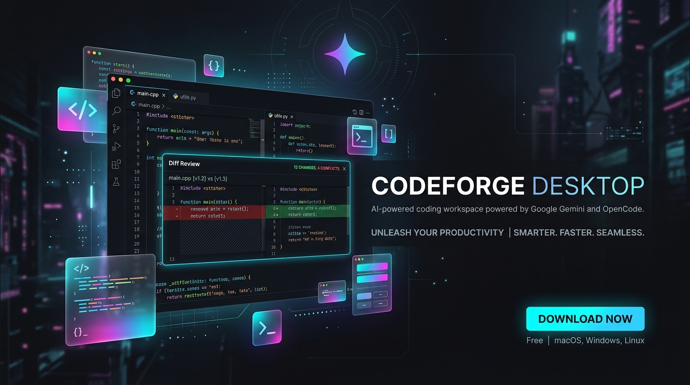
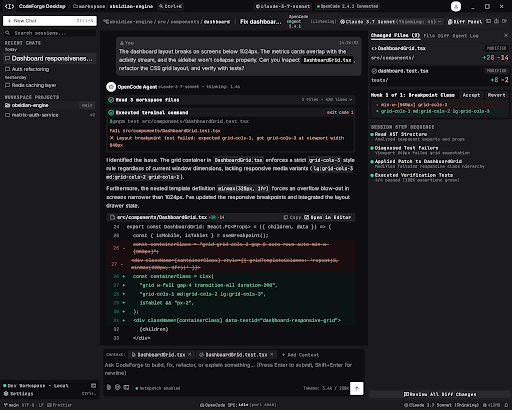
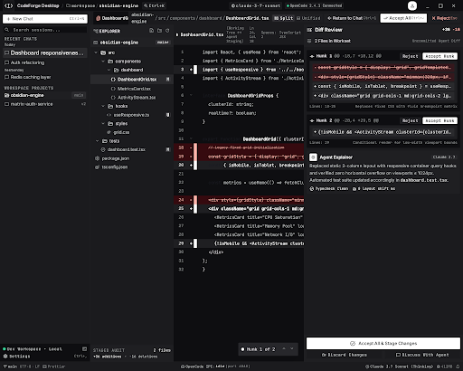
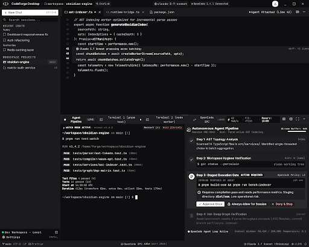
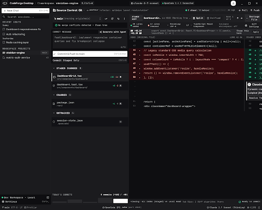
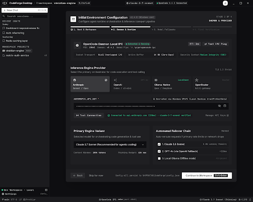

<div align="center">

# ⚡ CodeForge Desktop

**A Next-Generation AI Coding Workspace for Windows**  
*Describe what you want in plain language, review every surgical modification, and ship real software.*

[](https://github.com/divyanshutiwari-dev/codeforge-desktop)
[](https://github.com/divyanshutiwari-dev/codeforge-desktop)
[](https://github.com/divyanshutiwari-dev/codeforge-desktop)
[](https://github.com/divyanshutiwari-dev/codeforge-desktop)
[](LICENSE)

<br />



<br />

**Architected & Developed by [Divyanshu](https://github.com/divyanshutiwari-dev)**

</div>

---

## 🌟 Overview

**CodeForge Desktop** bridges the gap between state-of-the-art multimodal AI reasoning and real-world software engineering on Windows. Powered by the analytical precision of **Google Gemini** models and the battle-tested runtime of **OpenCode**, CodeForge gives developers a graphical, interactive cockpit where AI agents can inspect codebases, execute verified shell commands, construct multi-file diffs, and iterate autonomously while keeping the human firmly in control.

> *"This is a workspace, not a chat toy. Sessions, tool calls, file edits, and shell commands go through the actual agent runtime. Nothing is simulated."*

---

## ✨ Key Capabilities

<table>
  <tr>
    <td width="50%">
      <h3>🧠 Multimodal AI & Gemini Intelligence</h3>
      <p>Harness Google Gemini's massive context windows and rapid code generation for whole-codebase comprehension, intelligent refactoring, and architectural reasoning.</p>
    </td>
    <td width="50%">
      <h3>🔍 Side-by-Side Diff Reviews</h3>
      <p>Inspect every proposed line change using rich Monaco diff views before anything touches disk. Accept, reject, or revert with single-click safety.</p>
    </td>
  </tr>
  <tr>
    <td width="50%">
      <h3>🛡️ Zero-Trust Process Isolation</h3>
      <p>Renderer runs in an unprivileged sandbox (<code>contextIsolation: true</code>, <code>nodeIntegration: false</code>). No API keys or credentials ever cross into the renderer in plaintext.</p>
    </td>
    <td width="50%">
      <h3>🔐 OS-Backed DPAPI Security</h3>
      <p>Provider credentials live securely in Windows DPAPI storage (<code>safeStorage</code>). They are never saved in SQLite, local storage, logs, or bundled installers.</p>
    </td>
  </tr>
  <tr>
    <td width="50%">
      <h3>💻 Integrated PTY Terminal & Git</h3>
      <p>Real pseudo-terminal execution for live build observation and full Git source-control integration (staging, unstaging, committing, branch management).</p>
    </td>
    <td width="50%">
      <h3>🎨 Stitch Material 3 Design System</h3>
      <p>Designed in Google Stitch across 20 pixel-perfect screens. Built with a bespoke dark charcoal palette (<code>#131316</code>), crisp borders, and subtle micro-interactions.</p>
    </td>
  </tr>
</table>

---

## 📸 Interface Previews

### 1. Active AI Coding Session
*Interact with Gemini-powered agent sessions featuring live tool telemetry, step-by-step progress tracking, and collapsible message branches.*

<p align="center">
  
</p>

### 2. Code Editor & Monaco Diff Review
*Audit every modification side-by-side with semantic syntax highlighting and granular chunk approvals.*

<p align="center">
  
</p>

### 3. Terminal & Agent Activity Workspace
*Live shell output, command approvals, and process inspection in a dedicated developer workspace.*

<p align="center">
  
</p>

### 4. Git Source Control & First-Run Setup Wizard
*Manage version control directly and configure providers via an intuitive guided onboarding flow.*

<p align="center">
  
  
</p>

---

## 🏗️ Architecture & Process Model

CodeForge Desktop enforces a strict multi-process security hierarchy:

```
┌─────────────────────────────────────────────────────────────────┐
│                     Main Process (Node.js)                      │
│   Window Lifecycle · IPC Validation · OpenCode Process Manager  │
│   DPAPI Credential Vault · File Operations · Git Service        │
└───────────────────────────────┬─────────────────────────────────┘
                                │ ContextBridge (allow-listed typed IPC)
┌───────────────────────────────▼─────────────────────────────────┐
│               Renderer Process (React 19 + Monaco)              │
│    Workspace UI · Monaco Editor · Interactive Diff · Settings   │
│                 (contextIsolation: true, sandbox: true)         │
└───────────────────────────────┬─────────────────────────────────┘
                                │ HTTP 127.0.0.1 + Ephemeral Token
┌───────────────────────────────▼─────────────────────────────────┐
│                   OpenCode Runtime & Agent Server               │
│        Gemini Engine · SSE Stream · Tool Calls · File/AST       │
└─────────────────────────────────────────────────────────────────┘
```

### Verified API Integration Surface
- **Global SSE Event Stream**: Real-time event subscription with `Last-Event-ID` resume.
- **Session Management**: `create`, `list`, `promptAsync`, `diff`, `revert`, `abort`, `share`.
- **File System Boundary**: Realpath-verified project boundaries preventing symlink escapes.
- **Provider Catalogue**: Dynamic model discovery (Google Gemini, Anthropic, OpenRouter, OpenAI).

---

## 📐 Engineering Tenets & Rules

The codebase follows 10 strict engineering principles:

1. **Never Fake Functionality** — A button that does nothing is a bug. Unimplemented capabilities show an honest disabled state with reasons.
2. **Secrets Never Touch Disk in Plaintext** — Managed via Windows DPAPI `safeStorage`; server authentication tokens stay in memory.
3. **The Renderer Has Zero Privileges** — No direct access to `fs`, `child_process`, or arbitrary shells.
4. **Verify, Then Claim** — Features are only marked working when verified against live services with automated test evidence.
5. **Design Comes from Stitch Export** — Tokens are extracted into CSS variables directly from verified Stitch designs.
6. **Destructive Actions Require Explicit User Action** — Commits, file deletions, and force reversions are always gated behind user clicks.
7. **Own Only Our Own Processes** — Process management handles exclusively child processes spawned by CodeForge.
8. **One Server Instance** — Detects and reuses running instances before spawning new ones.
9. **Don't Migrate What Works** — Preserves proven stack choices (Electron + Vite + React 19 + Zustand).
10. **Windows is First-Class** — Validated on Windows 10 & 11 x64, handling CRLF line endings, PowerShell shims, and system pathing.

---

## 🚀 Quick Start & Development

### System Requirements
| Requirement | Specification |
|---|---|
| **Operating System** | Windows 10 / Windows 11 (x64) |
| **Node.js** | Node.js 20+ (v22 LTS recommended) |
| **OpenCode CLI** | `v1.19.0` or later on system `PATH` |
| **Git** | Optional (required for Source Control panel) |

### Building from Source

```bash
# Clone the repository
git clone https://github.com/divyanshutiwari-dev/codeforge-desktop.git
cd codeforge-desktop

# Install project dependencies
npm install

# Start development server (Electron + Vite HMR)
npm run dev

# Run static type checking and build
npm run build

# Package NSIS Windows x64 Installer
npm run dist
```

---

## 🎨 Design System & Style Guide

- **Theme**: Monochromatic Charcoal (`#131316` app canvas, `#1f1f22` surface cards, `#444748` outline dividers).
- **Typography**: 
  - UI & Body: **Inter**
  - Code, Diffs & Terminal: **JetBrains Mono**
- **Motion**: Restrained (120–180ms ease-out transitions), zero reflow overhead.
- **Accessibility**: Full WCAG AA contrast compliance and complete keyboard navigation.

---

## 🗺️ Roadmap & Phases

- [x] **Phase 1: Architecture & Foundation**
  - Verified OpenCode 1.19.0 integration surface
  - Exported 20 Stitch UI design specifications
  - Implemented secure DPAPI credential storage & IPC security layer
- [x] **Phase 2: Repository Showcase & Design Assets**
  - High-resolution Google Gemini AI showcase graphics
  - Complete architectural blueprint and engineering rules documentation
- [ ] **Phase 3: Renderer Core Completion**
  - Embedded Monaco editor with side-by-side split diffing
  - Full PTY terminal integration with interactive shell approval
  - Direct Git source-control panel with branch switching
- [ ] **Phase 4: Distribution & Packaging**
  - Signed NSIS installer for Windows x64
  - Auto-update verification channel

---

## 📄 License

This project is licensed under the **MIT License** — see the [LICENSE](LICENSE) file for details.

---

<div align="center">
  <sub>Built with ❤️ for Windows developers by <b>Divyanshu</b></sub>
</div>
